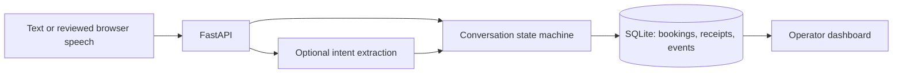

# Relay

**A voice-enabled scheduling assistant with a transaction-safe booking engine.**

Relay helps a fictional auto service business handle appointment requests, explicit confirmations, cancellations, rescheduling, and human handoffs. An operator dashboard provides appointment views, conversation history, action traces, and server-turn latency metrics.

The project explores a practical boundary: natural-language input can propose an action, but deterministic application code must validate and commit it.

## Quick start

Install Python 3.13+ and [uv](https://docs.astral.sh/uv/), then run these commands from the repository root:

```sh
uv sync --frozen --extra test
uv run --frozen uvicorn app.main:create_app --factory --host 127.0.0.1 --port 8765
```

Open [localhost:8765](http://127.0.0.1:8765). The default guided mode needs no API key or external database. On systems with Make, `make setup` and `make run` are equivalent.

### Try it

1. Type `inspection tomorrow`, or choose a service in the assistant.
2. Select an offered time.
3. Type `confirm` to book it. Selecting a slot alone does not reserve it.
4. Try `my appointments`, `reschedule`, or `cancel`.
5. Type `human`, then resolve the request in the operator's handoff queue.

For a particular date, use `inspection YYYY-MM-DD`. When several appointments exist, include the displayed reference: `cancel abc12345`.

## Capabilities

| Area | Implementation |
| --- | --- |
| Scheduling | Consultation, maintenance and inspection; one service bay; weekday business hours; Eastern time with DST conversion |
| Booking integrity | Explicit confirmation, interval conflict checks, five-minute proposal expiry, atomic rescheduling |
| Retry handling | Durable request IDs and input hashes; matching retries replay the committed response |
| Conversations | Persistent sessions, transcripts, guided commands, optional OpenAI intent extraction |
| Voice interface | Browser dictation into an editable input; optional reply read-aloud |
| Operator workspace | Appointment filters, session inspection, activity stream, handoff queue, server-turn p95 |
| Operations | Readiness/liveness endpoints, structured logs, online backup, Docker configuration, CI workflow |

Availability returns the first eight openings, with 15 minutes of lead time. Hours are Monday–Friday, 9am–5pm America/New_York. Appointments and messages persist in `data/relay.db`.

## How it works



The model receives no database access. Model-produced confirmations cannot authorize writes. The server commits only an explicit user confirmation of an existing proposal, after rechecking availability. Rescheduling and conflict checks run inside the same write transaction; a failed replacement preserves the original appointment.

Read the [architecture decisions](docs/ARCHITECTURE.md) for transaction boundaries, failure semantics and tradeoffs.

## Optional natural-language mode

Guided mode supports documented commands. For broader phrasing, configure a model available to your OpenAI account that supports Responses structured outputs:

```sh
export LANGUAGE_MODE=openai
export OPENAI_API_KEY="your-key"
export OPENAI_MODEL="your-supported-model-id"
uv run --frozen uvicorn app.main:create_app --factory --host 127.0.0.1 --port 8765
```

Non-guided requests and limited scheduling state are sent to OpenAI. The API key stays on the server. The adapter validates structured intents, disables response storage with `store=False`, limits request time, and falls back to guided commands if the provider fails. Live model compatibility and interpretation accuracy still need account-backed evaluation.

Reference: [OpenAI structured outputs](https://developers.openai.com/api/docs/guides/structured-outputs?api-mode=responses).

## Voice behavior

Dictation fills the message field; review and send it. Browser support varies and your browser may send audio to its speech provider. Read-aloud uses browser synthesis. Starting dictation or disabling read-aloud stops playback. Text input remains available without microphone access.

This is a turn-based browser interface, not a full-duplex telephony integration.

## Tests and evaluations

```sh
uv run --frozen --extra test pytest tests -q --cov=app --cov-report=term-missing
uv run --frozen python scripts/evaluate.py
node --check app/static/app.js
```

The standalone suite has 30 passing tests and 93% app statement coverage in the recorded local run. It exercises booking conflicts, concurrent retries, session ownership, rollback, rescheduling, confirmation expiry, DST and language-provider failures. Eight deterministic conversation scenarios write their outcomes to `artifacts/evaluation.json` using isolated temporary databases.

See the [validation record](docs/VALIDATION.md) for measured results and verification limits. These scenarios test workflow behavior, not speech recognition or model accuracy. The dashboard's p95 excludes browser speech and language-provider latency.

## Configuration and deployment

See [.env.example](.env.example). Export variables or use `uvicorn --env-file .env`; environment files are not loaded automatically.

- `APP_MODE=local` accepts loopback clients and local Host headers only.
- `ADMIN_TOKEN` protects operator routes when set. Local mode without a token is intended for a single-user development machine.
- `APP_MODE=production` requires an operator token of at least 32 characters. It does not supply customer accounts or make the app production-ready.
- `DATABASE_PATH` defaults to `data/relay.db`.

To run the container locally, set a long random operator token and start Compose:

```sh
export ADMIN_TOKEN="replace-with-a-long-random-secret"
docker compose up --build
```

Compose binds to localhost and persists its database in a named volume. Use a different port or stop the Python server if port 8765 is already occupied.

For backups, recovery and deployment prerequisites, see the [operations runbook](docs/OPERATIONS.md).

## Scope and limits

Relay is a local portfolio application with a simulated calendar and real persistence. It does not connect to external calendars or send notifications. Session access uses a capability stored in the browser tab; closing it can lose customer access to that session. There is no customer account recovery, distributed rate limiting, automated data retention, or multi-instance database design.

Use demo data. Messages are stored locally, and optional language/speech providers may receive input. Public hosting requires additional identity, abuse prevention, TLS and retention controls. See the [roadmap](ROADMAP.md).

## Repository layout

```text
app/          API, scheduling engine, language adapter and dashboard
tests/       Scheduling, concurrency, API and language adapter tests
scripts/     Deterministic evaluations and online backup utility
docs/        Architecture, operations and validation notes
```

See [provenance](PROVENANCE.md) for the project's origin and repository boundary. No open-source license has been selected yet.
